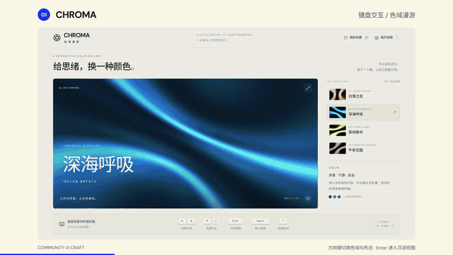
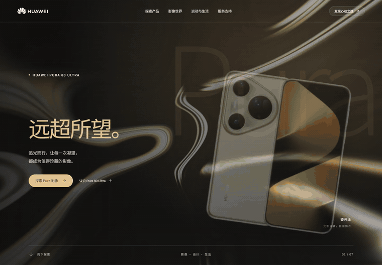
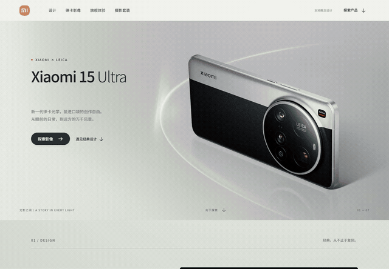

# Community UI Craft

A UI design skill for websites, software interfaces, dashboards, and HTML presentations. It covers community resource selection, acquisition, integration, typography, motion, and browser validation. The skill instructions are in Chinese.

[中文](README.md) · [Skill](skills/community-ui-craft/SKILL.md) · [Portable edition](portable/community-ui-craft.md) · [Showcase](docs/SHOWCASE.md)

## Interfaces built with the skill

Six examples are included. Huawei and Xiaomi: built with GPT-6 Astra / medium. Keyboard gallery, outdoor website, pet App, and research presentation: built with GPT-6 Sol / medium.

| Example | Motion preview | Overview |
|---|---|---|
| Huawei product page | [GIF](docs/media/huawei-motion.gif) · [MP4](docs/media/huawei-walkthrough.mp4) | [Seven sections](docs/media/huawei-overview.jpg) |
| Xiaomi product page | [GIF](docs/media/xiaomi-motion.gif) · [MP4](docs/media/xiaomi-walkthrough.mp4) | [Seven sections](docs/media/xiaomi-overview.jpg) |
| CHROMA keyboard gallery | [Film from 00:03](docs/media/showcase-film.mp4#t=3) | [Interactions](docs/media/chroma-overview.jpg) |
| RIDGELINE outdoor website | [Film from 00:15](docs/media/showcase-film.mp4#t=15) | [Page views](docs/media/ridgeline-overview.jpg) |
| PAWPAW pet App | [Film from 00:28](docs/media/showcase-film.mp4#t=28) | [App screens](docs/media/pawpaw-overview.jpg) |
| PAPER CLUB research presentation | [Film from 00:40](docs/media/showcase-film.mp4#t=40) | [Chart interactions](docs/media/seismic-overview.jpg) |

### Four interfaces · GPT-6 Sol / medium

A keyboard-controlled gallery, an outdoor brand website, a 15-screen pet App, and a 15-section research presentation. The reel uses recordings of the completed interfaces, with editorial cuts.



[56-second film MP4](docs/media/showcase-film.mp4) · [Overview](docs/media/showcase-overview.jpg) · [Case records and sources](docs/SHOWCASE.md)

| Case | Interaction | Components |
|---|---|---|
| [CHROMA · Keyboard gallery](docs/examples/chroma.md) | Arrow-key color and shape changes, immersive mode | React Bits ColorBends / BlurText, Animate UI, Lucide, Three.js and Motion |
| [RIDGELINE · Outdoor website](docs/examples/ridgeline.md) | Backpack hotspots, layer selection, night chapter | React Bits Threads / ScrollReveal / TiltedCard, Animate UI, Radix and Lucide |
| [PAWPAW · Pet lifestyle App](docs/examples/pawpaw.md) | Home interactions, product details, service screens | Radix Themes, Animate UI, Phosphor, Motion and OpenMoji |
| [PAPER CLUB · Research presentation](docs/examples/seismic.md) | Parameter controls, metric selection, sensitivity charts | Vanta Waves / Three.js, GSAP SplitText, UIkit, Apache ECharts and KaTeX |


### Huawei product page · GPT-6 Astra / medium

A seven-section product concept. Components include React Bits, Animate UI, Radix, Swiper, and Phosphor, alongside official product imagery.



[Full recording](docs/media/huawei-walkthrough.mp4) · [Seven-section overview](docs/media/huawei-overview.jpg) · [Case record](docs/examples/huawei.md)

### Xiaomi product page · GPT-6 Astra / medium

A seven-section Xiaomi 15 Ultra concept. It uses React Bits Silk, BlurText, ScrollReveal, and TiltedCard; Animate UI, Radix, Swiper, and official product imagery for animated surfaces, scroll typography, color selection, and controls.



[Full recording](docs/media/xiaomi-walkthrough.mp4) · [Seven-section overview](docs/media/xiaomi-overview.jpg) · [Case record](docs/examples/xiaomi.md)

## Prerequisites

| Requirement | Purpose |
|---|---|
| AI coding tool | Reads skill files, edits project files, runs terminal commands, and searches or retrieves official documentation. |
| Workspace | A writable project directory. For an existing project, provide its source and startup instructions. |
| Network access | Both the research tool and the download/install environment must reach relevant sources, including GitHub, npm, component documentation, and asset providers. |
| Node.js / npm | Required for npm components, React/Vite projects, and the Skills CLI below. Install a project-compatible [Node.js LTS](https://nodejs.org/en/download) and check `node --version` and `npm --version`. |
| Browser tools | The AI needs to open pages, take screenshots, scroll, and click. Its browser must be able to reach the project's preview server; a remote browser needs a reachable preview address. |
| Graphics support | Three.js and WebGL backgrounds need the corresponding WebGL support in the preview browser. |

Use the coding tool's built-in browser capability or configure [Playwright](https://playwright.dev/docs/browsers). A chat-only environment can support planning and code generation; visual validation also needs a running project and browser control.

Install dependencies per project. The AI selects Three.js, p5.js, D3, and other libraries as needed. Plain HTML projects use the runtime required by their selected components. Cached resources can support offline work; initial acquisition usually needs internet access.

## Permissions

- **Files:** read the skill, references, and project; write source, downloaded resources, and build output.
- **Terminal:** install dependencies, build, and manage the preview server for the task.
- **Network:** retrieve documentation, components, fonts, and appropriately licensed assets.
- **Browser:** open the preview, capture screenshots, and test interactions and viewport sizes.

Keep permissions scoped to the project. Global skill installation also requires write access to the selected skill directory. Routine use does not require administrator access. Public deployment, paid services, and account operations require task-specific authorization.

## Installation

Download and extract this repository. Install the entire `skills/community-ui-craft/` directory in your AI tool's supported skill location, including `references/` and `assets/`.

Alternatively, run the [Skills CLI](https://github.com/vercel-labs/skills) from the extracted repository root:

```sh
npx skills add . --skill community-ui-craft
```

Select your tool and installation scope, then invoke the skill in a new task.

For tools without skill support, attach [the portable edition](portable/community-ui-craft.md) as task instructions.

## Example prompt

```text
Use community-ui-craft to build a website about [your theme].
Include at least six sections in a vertical browsing experience.
Choose the design. Check the environment and available permissions,
then acquire and integrate suitable community components and assets.
Check layout, motion, interactions, and narrow screens in a browser;
fix issues and deliver the result.
```

Include any required framework, brand assets, offline requirements, or delivery format in the task.

## Project dependencies and preview

Once the site is generated, install dependencies and start the preview from the site directory containing `package.json`. A typical npm project uses:

```sh
cd "path/to/your-site"
npm install
npm run dev
```

Open the local address printed by the terminal. Follow the generated project's README and `package.json` for its exact commands; preserve an existing project's package manager and lockfile. For offline delivery, request local images, fonts, runtime assets, and an offline check.

## Resources and files

See the [resource map](skills/community-ui-craft/references/resource-map.md) for sources, acquisition methods, and use cases. It covers React Bits, Codrops, Animate UI, Radix, shadcn/ui, Phosphor, D3, ECharts, Three.js, p5.js, and other resources.

```text
skills/community-ui-craft/   Skill, references, and resource manifest template
portable/                   Combined single-file edition
docs/                       Examples, screenshots, and recordings
```

## License

Original skill instructions and documentation use [MIT](LICENSE). Community components, fonts, and depicted brand assets retain their respective licenses. The Huawei and Xiaomi examples are unofficial concepts; see [third-party notices](THIRD_PARTY_NOTICES.md) for sources and rights.
