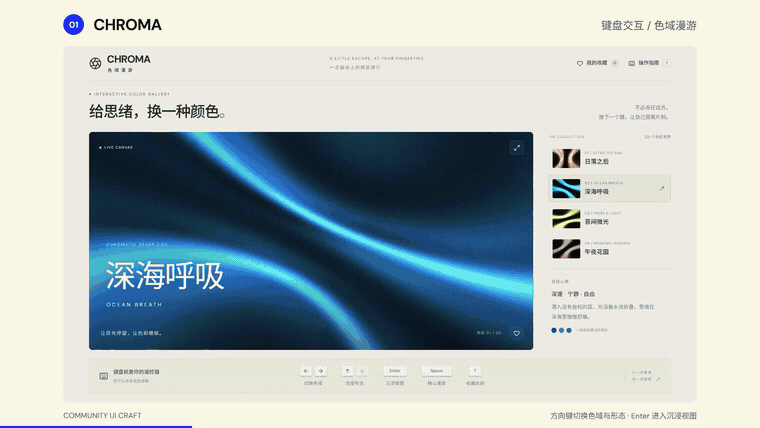
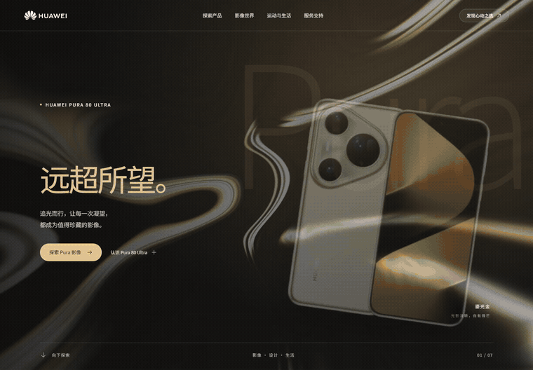
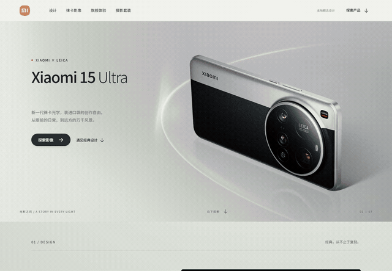

# Community UI Craft

面向网站、软件界面、数据平台和 HTML 展示的 UI 设计 skill。提供公共组件与素材的获取途径、选型方法、接入流程，以及排版、动效和浏览器验收要求。

[English](README.en.md) · [技能正文](skills/community-ui-craft/SKILL.md) · [单文件版](portable/community-ui-craft.md) · [案例详情](docs/SHOWCASE.md)

## 使用 skill 制作的界面效果

共六组案例。华为、小米：GPT-6 Astra / medium 制作效果。键盘画廊、登山网站、宠物 App、研究汇报：GPT-6 Sol / medium 制作效果。

| 案例 | 动态预览 | 页面总览 |
|---|---|---|
| 华为产品页 | [GIF](docs/media/huawei-motion.gif) · [MP4](docs/media/huawei-walkthrough.mp4) | [七板块](docs/media/huawei-overview.jpg) |
| 小米产品页 | [GIF](docs/media/xiaomi-motion.gif) · [MP4](docs/media/xiaomi-walkthrough.mp4) | [七板块](docs/media/xiaomi-overview.jpg) |
| CHROMA 键盘画廊 | [宣传片 00:03 起](docs/media/showcase-film.mp4#t=3) | [交互画面](docs/media/chroma-overview.jpg) |
| RIDGELINE 登山网站 | [宣传片 00:15 起](docs/media/showcase-film.mp4#t=15) | [页面画面](docs/media/ridgeline-overview.jpg) |
| PAWPAW 宠物 App | [宣传片 00:28 起](docs/media/showcase-film.mp4#t=28) | [页面画面](docs/media/pawpaw-overview.jpg) |
| PAPER CLUB 研究汇报 | [宣传片 00:40 起](docs/media/showcase-film.mp4#t=40) | [图表交互](docs/media/seismic-overview.jpg) |

### 四组界面 · GPT-6 Sol / medium

键盘画廊、登山品牌网站、15 页面宠物 App，以及 15 章节 HTML 研究汇报。以下片段录自完成后的真实界面，并经过剪辑。



[56 秒宣传片 MP4](docs/media/showcase-film.mp4) · [画面总览](docs/media/showcase-overview.jpg) · [案例详情与来源](docs/SHOWCASE.md)

| 案例 | 主要交互 | 使用的组件 |
|---|---|---|
| [CHROMA · 键盘交互画廊](docs/examples/chroma.md) | 方向键切换、形态与配色、沉浸模式 | React Bits ColorBends / BlurText、Animate UI、Lucide、Three.js、Motion |
| [RIDGELINE · 登山品牌网站](docs/examples/ridgeline.md) | 背包热点、分层切换、山夜章节 | React Bits Threads / ScrollReveal / TiltedCard、Animate UI、Radix、Lucide |
| [PAWPAW · 宠物生活 App](docs/examples/pawpaw.md) | 首页交互、商品详情、服务页面 | Radix Themes、Animate UI、Phosphor、Motion、OpenMoji |
| [PAPER CLUB · HTML 研究汇报](docs/examples/seismic.md) | 参数变化、指标切换、参数敏感性 | Vanta Waves / Three.js、GSAP SplitText、UIkit、Apache ECharts、KaTeX |


### 华为产品页 · GPT-6 Astra / medium

七板块产品概念页，使用 React Bits、Animate UI、Radix、Swiper、Phosphor 和官方产品素材。



[完整录像 MP4](docs/media/huawei-walkthrough.mp4) · [七板块总览](docs/media/huawei-overview.jpg) · [案例记录](docs/examples/huawei.md)

### 小米产品页 · GPT-6 Astra / medium

Xiaomi 15 Ultra 七板块概念页，包含背景动效、滚动文字、配色切换和交互控件。使用 React Bits Silk / BlurText / ScrollReveal / TiltedCard、Animate UI、Radix、Swiper 和官方产品素材。



[完整录像 MP4](docs/media/xiaomi-walkthrough.mp4) · [七板块总览](docs/media/xiaomi-overview.jpg) · [案例记录](docs/examples/xiaomi.md)

## 使用前准备

| 项目 | 要求与用途 |
|---|---|
| AI 工具 | 能读取 skill、编辑项目文件、执行终端命令，并检索网页或读取官方文档。技能正文为中文。 |
| 项目目录 | 准备一个允许 AI 读写的工作目录。修改现有项目时提供源码和启动方式。 |
| 网络 | AI 的检索工具和下载、安装依赖的终端均需能访问相关网站。常用来源包括 GitHub、npm、组件官网和字体/图片来源站点。 |
| Node.js / npm | 使用 npm 组件、React/Vite 工程或下方 Skills CLI 时需要。建议安装兼容项目的 [Node.js LTS](https://nodejs.org/en/download)，并在终端确认 `node --version`、`npm --version` 可用。 |
| 浏览器预览 | 配置 AI 可操作的浏览器工具，支持打开页面、截图、滚动和点击。浏览器需要能访问项目的本地预览服务；远程运行的 AI 浏览器需配置可达的预览地址。 |
| 图形支持 | 使用 Three.js 或 WebGL 背景时，预览浏览器需支持对应的 WebGL 功能。 |

使用工具自带的浏览器能力，或按需配置 [Playwright](https://playwright.dev/docs/browsers)。只有聊天和附件功能的环境适合阅读、规划与生成代码；完成效果验收还需要项目运行和浏览器操作能力。

依赖按项目安装。Three.js、p5.js、D3 等由 AI 根据任务选择，无需预先全部装到全局。原生 HTML 项目按所选组件确定运行环境。已有可用依赖时可继续离线开发；首次获取组件和素材通常需要联网。

## 所需权限

- **文件读写**：读取 skill、参考素材和项目文件，写入源码、下载资源与构建产物。
- **终端执行**：安装项目依赖、构建项目，启动和停止本次任务的本地预览服务。
- **网络访问**：查询官方文档，下载组件、字体和许可允许使用的素材。
- **浏览器操作**：访问预览页面，截图并验证交互和不同窗口尺寸。

权限以项目范围为主；安装到全局 skill 目录时还需该目录的写入权限。常规使用无需管理员权限。公开部署、付费服务和账号操作按具体任务另行授权。

## 安装

下载并解压仓库，将整个 `skills/community-ui-craft/` 目录安装到 AI 工具支持的 skill 目录，保留其中的 `references/` 和 `assets/`。

也可在解压后的仓库根目录使用 [Skills CLI](https://github.com/vercel-labs/skills)：

```sh
npx skills add . --skill community-ui-craft
```

按提示选择 AI 工具和安装范围。安装完成后，在新任务中调用技能。

不支持 skill 目录的工具，可上传 [单文件版](portable/community-ui-craft.md) 作为任务指引。

## 调用示例

```text
使用 community-ui-craft，制作一个关于「你的主题」的网站。
至少 6 个板块，向下浏览，具体设计自行发挥。
先检查运行环境和可用权限，再获取并接入合适的公共组件与素材。
完成后在浏览器中检查排版、动效、交互和窄屏效果，自行修正并交付。
```

如有指定框架、品牌资料、离线要求或交付形式，一并写入任务。

## 项目依赖与预览

网站生成后，在含有 `package.json` 的网站工程目录中安装依赖和启动预览。npm 工程通常使用：

```sh
cd "path/to/your-site"
npm install
npm run dev
```

打开终端显示的本地地址。具体命令以生成项目的 README 和 `package.json` 为准；已有工程沿用其包管理器及锁文件。需要离线交付时，在任务中要求本地保存图片、字体和运行资源，并进行断网验证。

## 资源与文件

组件入口、获取方法和适用场景见 [资源地图](skills/community-ui-craft/references/resource-map.md)。资源包括 React Bits、Codrops、Animate UI、Radix、shadcn/ui、Phosphor、D3、ECharts、Three.js 和 p5.js 等。

```text
skills/community-ui-craft/   技能入口、参考文档和资源记录模板
portable/                   合并后的单文件版
docs/                       案例、截图和录屏
```

## 许可

原创技能和文档采用 [MIT](LICENSE)。社区组件、字体及案例中的品牌素材遵循各自许可。华为和小米案例均为非官方概念展示；素材来源与权利说明见 [THIRD_PARTY_NOTICES.md](THIRD_PARTY_NOTICES.md)。
