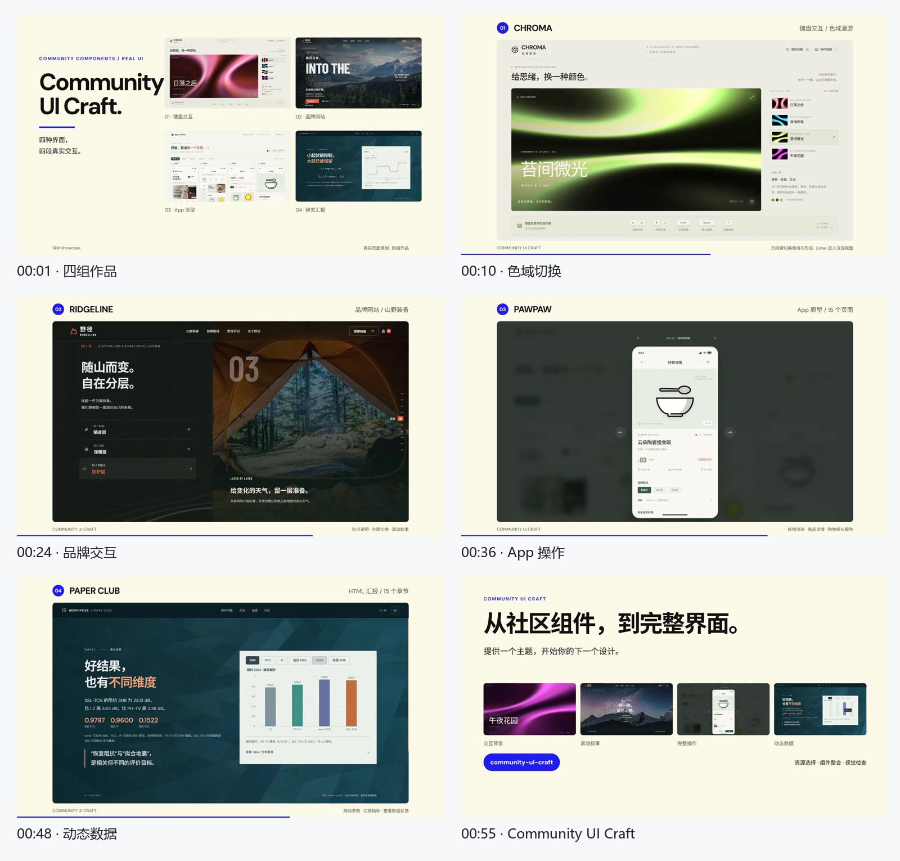
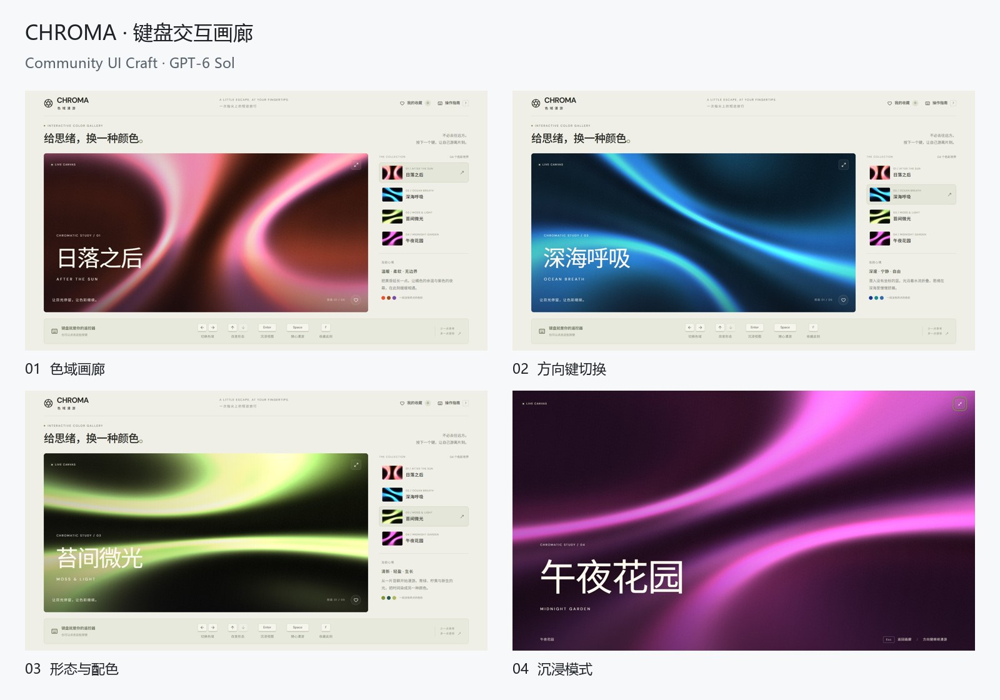
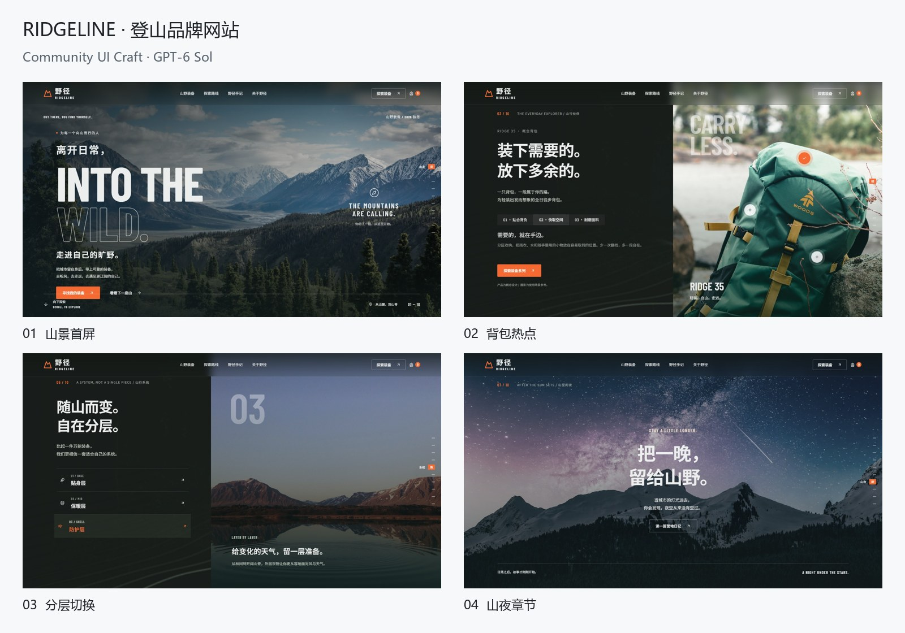
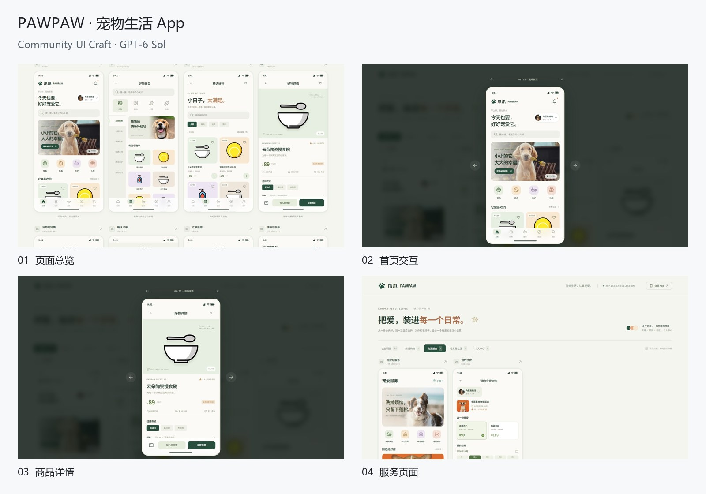
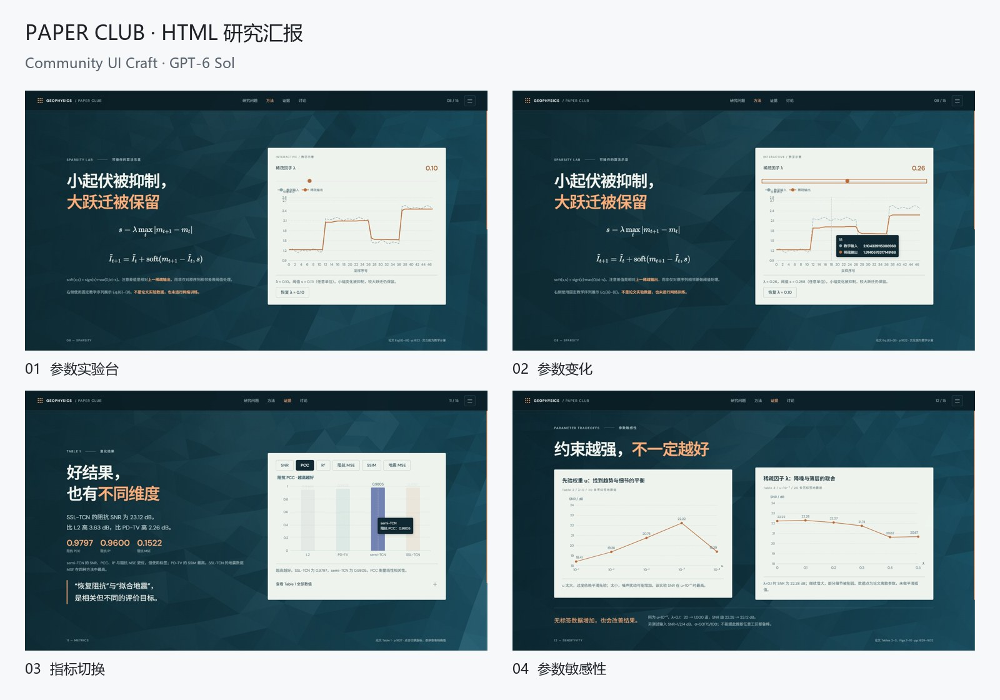
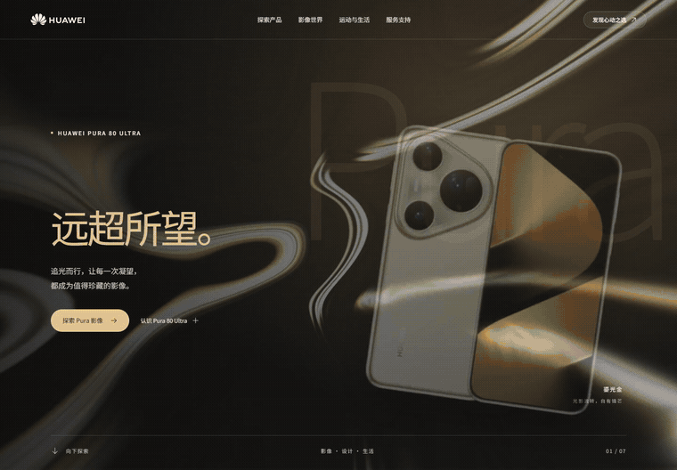
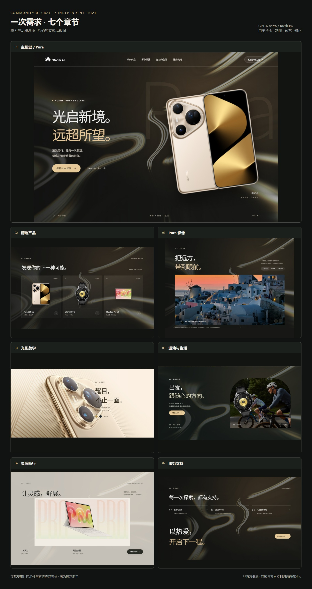
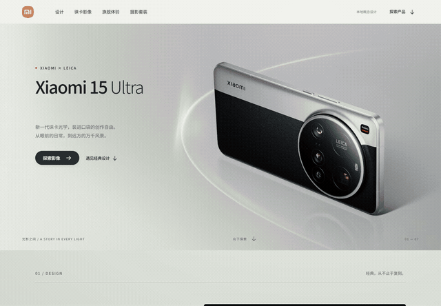
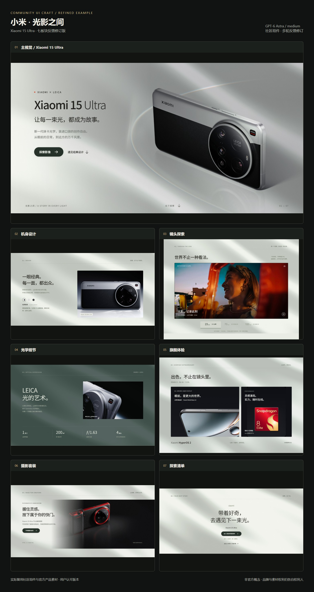

# 案例展示

六组案例：华为、小米、CHROMA、RIDGELINE、PAWPAW 和 PAPER CLUB。四组新作品剪辑为 56 秒宣传片；华为、小米分别提供动态片段与完整录像。

| 案例 | 动态预览 | 截图 |
|---|---|---|
| 华为 | [GIF](media/huawei-motion.gif) · [完整 MP4](media/huawei-walkthrough.mp4) | [七板块总览](media/huawei-overview.jpg) |
| 小米 | [GIF](media/xiaomi-motion.gif) · [完整 MP4](media/xiaomi-walkthrough.mp4) | [七板块总览](media/xiaomi-overview.jpg) |
| 四组新作品 | [摘要 GIF](media/showcase-teaser.gif) · [宣传片 MP4](media/showcase-film.mp4) | [画面总览](media/showcase-overview.jpg) |

## 四案例宣传片 · GPT-6 Sol / medium

[56 秒 MP4](media/showcase-film.mp4) · [动态摘要 GIF](media/showcase-teaser.gif)

### CHROMA · 键盘交互画廊

[案例说明](examples/chroma.md)

### RIDGELINE · 登山品牌网站

[案例说明](examples/ridgeline.md)

### PAWPAW · 宠物生活 App

[案例说明](examples/pawpaw.md)

### PAPER CLUB · HTML 研究汇报

[案例说明](examples/seismic.md)

## 华为 · GPT-6 Astra / medium

产品概念页，包含七个板块。

[完整录像](media/huawei-walkthrough.mp4) · [案例记录](examples/huawei.md)

## 小米 · GPT-6 Astra / medium

Xiaomi 15 Ultra 七板块概念页，包含流动背景、滚动文字和产品交互。

[完整录像](media/xiaomi-walkthrough.mp4) · [案例记录](examples/xiaomi.md)

## 原始章节截图

| 板块 | 华为 | 小米 |
|---|---|---|
| 1 | [主视觉](media/huawei-1-home.jpg) | [主视觉](media/xiaomi-1-home.jpg) |
| 2 | [精选产品](media/huawei-2-collection.jpg) | [机身设计](media/xiaomi-2-design.jpg) |
| 3 | [Pura 影像](media/huawei-3-imaging.jpg) | [镜头探索](media/xiaomi-3-camera.jpg) |
| 4 | [光影美学](media/huawei-4-design.jpg) | [光学细节](media/xiaomi-4-optics.jpg) |
| 5 | [运动与生活](media/huawei-5-wearables.jpg) | [旗舰体验](media/xiaomi-5-performance.jpg) |
| 6 | [灵感随行](media/huawei-6-create.jpg) | [摄影套装](media/xiaomi-6-kit.jpg) |
| 7 | [服务支持](media/huawei-7-service.jpg) | [探索清单](media/xiaomi-7-explore.jpg) |

媒体直接采集各案例页面。素材来源和许可见 [第三方说明](../THIRD_PARTY_NOTICES.md)。
