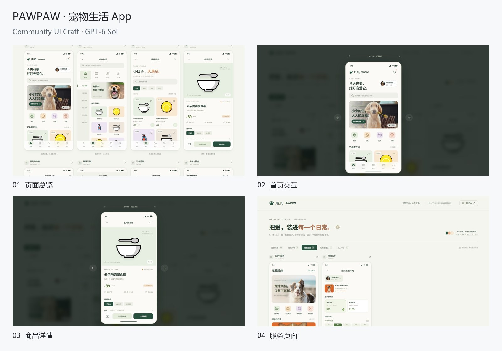

# PAWPAW · 宠物生活 App

创建模型：GPT-6 Sol / medium（创建者提供）。本记录展示完成后的界面与真实操作片段。

## 界面与交互

页面总览、首页交互、商品详情、服务页面。

## 使用的资源

Radix Themes、Animate UI、Phosphor、Motion、OpenMoji。组件参数、页面布局和状态逻辑根据主题适配。

## 录制

原始浏览器视口为 1600 × 900。录制使用独立浏览器环境，启用页面动效；内容来自原页面，未重绘成视频道具。宣传片加入标题、章节切换和节奏调整，登山与汇报片段有适度加速。

[四案例宣传片](../media/showcase-film.mp4) · [动态摘要](../media/showcase-teaser.gif) · [全部案例](../SHOWCASE.md)

商品插图由 [OpenMoji contributors](https://openmoji.org/) 创作，采用 [CC BY-SA 4.0](https://creativecommons.org/licenses/by-sa/4.0/)；画面中的宠物、用户、商品与订单信息为演示内容。

素材权利与来源见 [第三方说明](../../THIRD_PARTY_NOTICES.md)。
