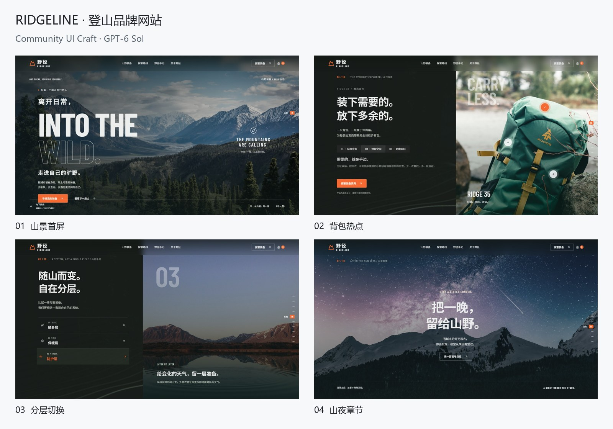

# RIDGELINE · 登山品牌网站

创建模型：GPT-6 Sol / medium（创建者提供）。本记录展示完成后的界面与真实操作片段。

## 界面与交互

山景首屏、背包热点、分层切换、山夜章节。

## 使用的资源

React Bits Threads / ScrollReveal / TiltedCard、Animate UI、Radix、Lucide。组件参数、页面布局和状态逻辑根据主题适配。

## 录制

原始浏览器视口为 1600 × 900。录制使用独立浏览器环境，启用页面动效；内容来自原页面，未重绘成视频道具。宣传片加入标题、章节切换和节奏调整，登山与汇报片段有适度加速。

[四案例宣传片](../media/showcase-film.mp4) · [动态摘要](../media/showcase-teaser.gif) · [全部案例](../SHOWCASE.md)

素材权利与来源见 [第三方说明](../../THIRD_PARTY_NOTICES.md)。
