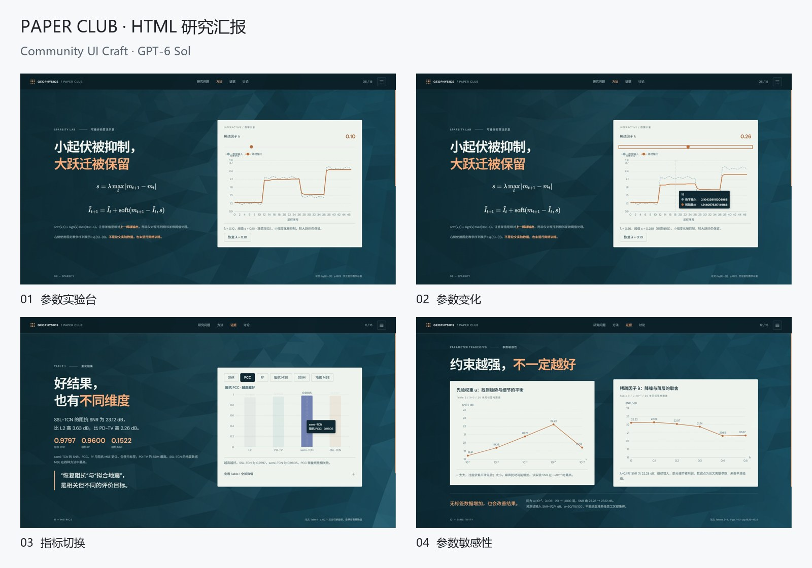

# PAPER CLUB · HTML 研究汇报

创建模型：GPT-6 Sol / medium（创建者提供）。本记录展示完成后的界面与真实操作片段。

## 界面与交互

参数实验台、参数变化、指标切换、参数敏感性。

## 使用的资源

Vanta Waves / Three.js、GSAP SplitText、UIkit、Apache ECharts、KaTeX。组件参数、页面布局和状态逻辑根据主题适配。

## 录制

原始浏览器视口为 1600 × 900。录制使用独立浏览器环境，启用页面动效；内容来自原页面，未重绘成视频道具。宣传片加入标题、章节切换和节奏调整，登山与汇报片段有适度加速。

[四案例宣传片](../media/showcase-film.mp4) · [动态摘要](../media/showcase-teaser.gif) · [全部案例](../SHOWCASE.md)

论文：Wang, Chen & Cheng (2025), [Physics-Guided Self-Supervised Seismic Impedance Inversion](https://doi.org/10.1007/s11004-025-10215-3)。展示选用界面生成的教学曲线和数据图表，教学序列与论文统计数值在页面中分别标注。本案例截图与宣传片未收入 PDF 或论文原图文件。

素材权利与来源见 [第三方说明](../../THIRD_PARTY_NOTICES.md)。
